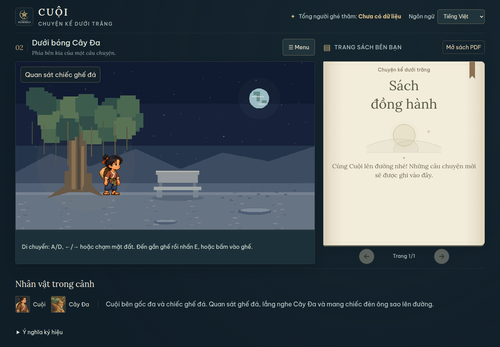

# CUỘI — Cuội, Hằng, and Their Forgotten Friends

## Introduction

**CUỘI** is a web game and picture book created by **Light of Memories** for primary school children. Players join Cuội in his search for Hằng, meet equipment left behind on the Moon, and discover its stories. The project brings together Vietnam’s Mid-Autumn Festival traditions and space exploration, with a star lantern symbolizing memory and friendship.

The project was developed for the challenge **Abandoned but not Forgotten: Storytelling about NASA's Discarded Equipment on the Moon and Mars**. Its visual style is warm and nostalgic, combining pixel art game scenes, a midnight blue interface, gold accents, and cream paper book pages.

The journey introduces five friends: **Surveyor 3 — Round Eye**, **Apollo 11 — Twinkle**, **Apollo 12 — Sharp Ear**, **Apollo 15 — Mesh Wheels**, and **LRO — Sky Watcher**. A companion book unlocks as players progress, connecting the story with scientific facts and archival images. The website supports **Vietnamese and English**, opens the story PDFs, and saves the journey in the current browser.

## Play the Game

Play online at [Light of Memories — CUỘI](https://light-of-memories.vercel.app/).




## Team Members

- Lê Phạm Thế Vũ
- Nguyễn Đức Mạnh
- Nguyễn Bảo An
- Nguyễn Thị Thanh An
- Cao Quốc Khánh
- Vũ Lê Đức Minh

Team roles and contributions are documented in the technical report available in the [shared Google Drive folder](https://drive.google.com/drive/folders/1QKIBXyY5a7Y-gi2FXehmMTYo2qvI2Mmz).

## Setup and Running

### Requirements

- Node.js 22.12 or later and npm.
- A modern browser with WebGL or Canvas support.

Download the source code and open a terminal in the project root, where `package.json` is located.

### Development

```bash
npm ci
npm run dev
```

Open the address Vite prints in the terminal, which defaults to `http://localhost:5173`. Stop the server with `Ctrl+C`.

### Checks and Production Build

```bash
# Check TypeScript types
npm run typecheck

# Check TypeScript and create a production build
npm run build

# Preview the site locally after a successful build
npm run preview
```

The build is written to `dist/` and can be deployed to a static website host. The visitor counter also requires the Vercel Function in `api/` and Upstash Redis, with two server-side environment variables: `UPSTASH_REDIS_REST_URL` and `UPSTASH_REDIS_REST_TOKEN`. See [technology and deployment details](docs/development/technology-stack.md#visitor-counter-services).

## Sources, AI, and Technology

The interface uses **React 19, TypeScript, and CSS**, while game scenes use **Phaser 3**. **Vite 6** handles development and builds, the **Web Audio API** synthesizes background music and sound effects, and `localStorage` saves progress in the browser.

| Topic | Documentation |
| --- | --- |
| Frameworks, libraries, tools, and services | [Technology Stack](docs/development/technology-stack.md) |
| Scientific sources and archival images | [References](docs/references.md) |
| Asset and font sources and accompanying licenses | [Public Assets](docs/README.md#static-assets) |
| AI tools and their roles | [AI Usage](docs/project/ai-usage.md) |

## Memories from the Journey

A place for the team’s memories of making the project, presentation slides, and introduction or demo videos.

**Shared Google Drive folder:** [Light-of-Memories](https://drive.google.com/drive/folders/1QKIBXyY5a7Y-gi2FXehmMTYo2qvI2Mmz).

## Project Documentation

See the [documentation index in docs/](docs/README.md) for guides to the code structure, visuals, audio, and all five chapters.
